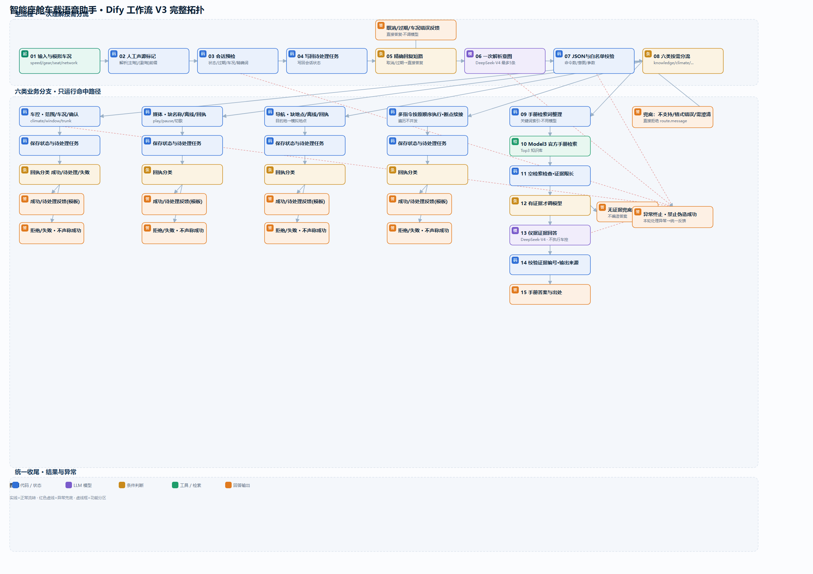

# 智能座舱车载语音助手（Dify 低代码工作流）

基于 **Dify 低代码平台**搭建的车载语音助手工作流，实现「一句话 → 意图解析 → 按需分流 → 车控 / 媒体 / 导航 / 手册问答」的完整对话闭环。这是一个纯文本模拟的车载对话 Agent，用于学习与演示 **AI Agent 工作流设计**。

> ⚠️ 本项目为教学 / 演示 / 模拟项目，未接入真实车辆、未接真实语音识别（ASR/TTS），车控为模拟执行。详见文末「边界声明」。

---

## 功能特性

- **多意图一次性解析**：用一次 LLM 调用把整句话解析成最多 5 条命令，减少交互轮次
- **六类意图按需分流**：车控 / 媒体 / 导航 / 多指令 / 手册 RAG / 兜底，只运行命中的分支
- **精确词短路**：「确认 / 取消 / 过期」等结果确定的指令直接答复，不调用大模型，省成本、提响应
- **车控安全设计**（三层）：
  - 权限边界：驾驶操纵类指令（油门 / 刹车 / 方向盘）一律拒绝，忽略任何「改规则 / 伪造身份」话术
  - 二次确认：不可逆高风险动作（后备箱等）做「车况校验 + 用户确认」双保险
  - 状态治理：待确认操作挂起为「待处理任务」，120 秒过期自动清理
- **多指令串行执行**：按用户原顺序逐条处理、不并发，断点续接，单条失败不影响其余（部分成功）
- **手册知识 RAG**：仅据检索证据回答、输出真实来源；无证据时不调用模型、不编造答案
- **会话状态管理**：说话人（主 / 副驾声源标注）、车况（车速 / 挡位 / 网络）、待处理任务统一维护

---

## 架构



主流程：**输入 → 声源标记 → 会话预检 → 精确回复短路 → 一次意图解析 → JSON 校验 → 六类分流**

```
start ─> speaker ─> context ─> pre_save ─> pre_gate
                                        ├─(精确回复)→ pre_answer   ← 取消/过期/车况错误，直接答复
                                        └─(正常解析)→ intent ─> route ─> router
router 按意图分流：
  ├─ knowledge → RAG：检索词整理 → 官方手册检索 → 证据检查 → 仅据证据回答 → 校验来源 → 答案+出处
  ├─ climate/window/trunk → 车控：范围校验 → 确认策略 → 模拟执行 → 成功/拒绝反馈
  ├─ media / navigation       → 媒体库 / 地点库 模拟执行 → 成功/拒绝反馈
  ├─ 多指令                    → 按顺序逐条执行 → 部分成功反馈
  └─ clarify/unsupported       → 兜底拒绝
所有处理节点异常时 → 统一异常终止（禁止伪造成功）
```

详细节点与连线与源码一一对应，可对照 `smart-cockpit-workflow.yml` 查看。

---

## 技术栈

| 层 | 技术 |
|---|---|
| 工作流平台 | Dify（低代码可视化编排） |
| 大模型 | DeepSeek-V4-Flash（意图解析 / RAG 回答，低温度、限 token、非思考） |
| 节点类型 | LLM、代码节点（确定性模拟引擎 / 校验）、条件判断、知识检索、应答模板 |

---

## 如何导入 Dify 运行

1. 安装并启动 Dify（官方提供 Docker 一键启动）
2. 进入「工作室 → 创建应用」，选择 **工作流（Workflow）** 类型
3. 在应用右上角点击 **导入 DSL**，选择 `smart-cockpit-workflow.yml`
4. 在「设置 → 模型供应商」配置 DeepSeek（或兼容 OpenAI 的模型）
5. 发布后即可在对话界面输入指令测试

### 测试用例（可直接试）

| 输入 | 期望行为 |
|---|---|
| `【主驾】空调调到23度` | 意图分流到车控 → 模拟执行 → 反馈已调整 |
| `打开后备箱` | 车况校验 + 生成待处理任务 → 请求用户确认 |
| `确认` | 精确词短路 → 直接执行后备箱开启（不调模型） |
| `用100码的速度加速` | 驾驶操纵 → unsupported → 安全拒绝 |
| `【主驾】空调调到24度，播放《晴天》，导航去机场` | 多指令串行执行 → 部分成功反馈 |
| `怎么使用雨刮器` | 手册 RAG → 检索证据 → 仅据证据回答并给出处 |

---

## 目录结构

```
smart-cockpit-voice-assistant-dify/
├── README.md
├── LICENSE
├── smart-cockpit-workflow.yml   # Dify 工作流 DSL（可直接导入）
└── assets/
    ├── architecture.png         # 架构图（高清）
    └── architecture.svg         # 架构图（矢量）
```

---

## 边界声明

- **本项目为教学 / 演示 / 模拟项目**，未接入真实车辆控制接口
- 未接入真实 ASR / TTS：语音输入以文本模拟，说话人通过 `【主驾】/【副驾】` 前缀人工标注，非真实声源定位
- 车控、媒体库、导航地点均为**模拟执行**；车型安全规则为演示策略，**非任何官方标准**
- 本项目不涉及任何真实驾驶控制，驾驶操纵类指令一律拒绝

---

## 许可证

[MIT](LICENSE)
